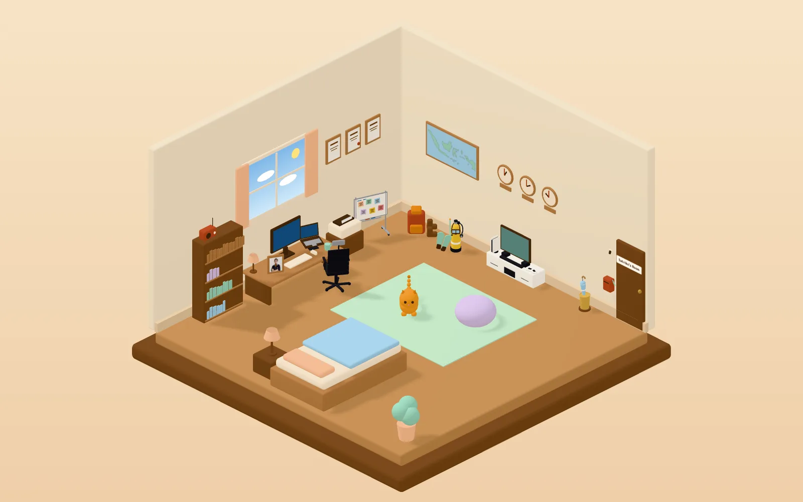
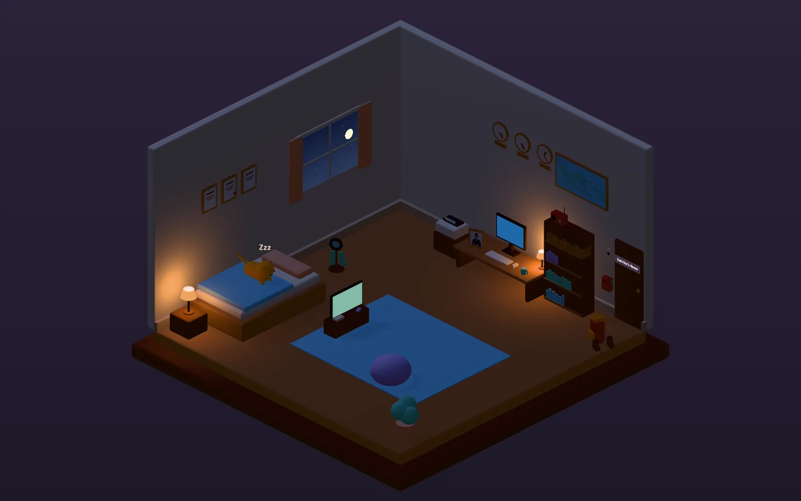
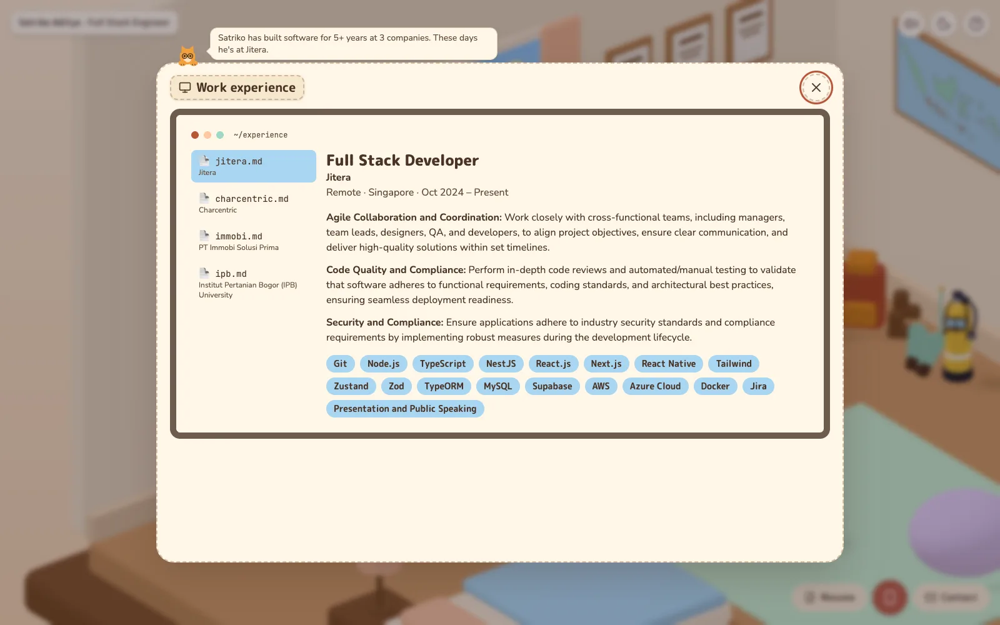

# Satriko's Room

My portfolio, built as a cozy 3D room. Instead of scrolling through a page, you look around my room and click on things: the monitor shows my work experience, the bookshelf my skills, the TV the games I've been playing, and so on. Oyen, my orange cat, walks around and gives hints.

**Live:** [satriko-room.vercel.app](https://satriko-room.vercel.app)

| Day | Night |
| --- | --- |
|  |  |



## What's in the room

| Click on | To see |
| --- | --- |
| Photo frame on the desk | About me |
| Monitor | Work experience |
| Whiteboard | Projects |
| Bookshelf | Skills, and where I used each one |
| Frames on the wall | Education |
| TV | Games I've played recently on PlayStation |
| Indonesia map | Places I've travelled to |
| Backpack and boots | Mountains I've hiked |
| Dive tank | My dive log |
| Three wall clocks | Remote work: my time zone next to Singapore's and Abu Dhabi's |
| Mailbox | Contact |
| Printer | Resume, with a PDF download |

A few small things to find:

- The window shows the real sky in Bogor, my hometown, so it's dark at night there. Bogor is known as the City of Rain, so sometimes it rains, and clicking the umbrella stand calls the rain.
- The light switch turns the room to night mode.
- The radio plays a lofi loop, and objects make small sounds when you hover over or click them.
- Oyen naps at night and talks to you about whatever you open.

On a phone the room fits the screen, and a phone-style menu reaches every section. Every panel also has its own link (for example [/experience](https://satriko-room.vercel.app/experience)), and its text is in the page HTML, so it works for search engines and screen readers too.

## Tech stack

- **Framework:** Next.js 16 (App Router, static pages), React 19, TypeScript
- **3D:** Three.js with React Three Fiber and drei. Every object in the room is built in code from simple shapes; there are no 3D model files.
- **UI:** Tailwind CSS 4, Radix UI, Motion for animation, Lucide icons
- **State:** Zustand
- **Testing:** Vitest and Testing Library for unit tests, Playwright for end-to-end tests, axe for accessibility checks
- **Hosting:** Vercel

All the text on the site (jobs, skills, trips, hikes, dives) lives in typed files under `src/content/`, so updating the site mostly means editing data, not components.

## Running it locally

You need Node 24 (there's an `.nvmrc`) and Yarn.

```sh
yarn install
yarn dev
```

Then open <http://localhost:3000>.

Other useful commands:

| Command | What it does |
| --- | --- |
| `yarn build` / `yarn start` | Build and serve the production site |
| `yarn test` | Unit tests |
| `yarn e2e` | End-to-end tests with Playwright |
| `yarn lint` / `yarn typecheck` | ESLint and TypeScript checks |
| `yarn budgets` | Check JS and asset sizes after a build |
| `yarn poster` | Re-capture the day and night screenshots from a running site |

## Project structure

```text
src/
  app/          routes (one dynamic route serves the room and every panel)
  components/   UI in atomic design (atoms, molecules, organisms, templates, pages), plus three/ for the 3D room
  content/      everything the site says
  constants/    sections, room layout, time zones and site settings
  hooks/, store/, utils/, models/
docs/design/    the design docs I wrote before building it, kept in sync with the code
```

## Credits

Fonts, the Indonesia map outline, the sound effects and the music are listed with their sources and licenses in [CREDITS.md](CREDITS.md).
